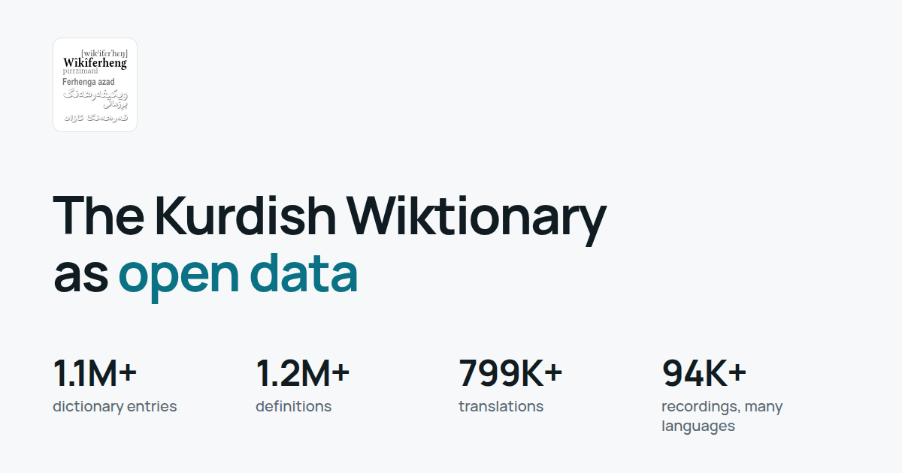

# wiktionary_to_mdx

Kurdish Wiktionary (Wîkîferheng) pipeline: Kiwix **ZIM** ingest, PostgreSQL storage, FastAPI query API, and **MDX/MDD** dictionary export via [mdict-utils](https://pypi.org/project/mdict-utils/).

<picture>
  <source media="(prefers-color-scheme: dark)" srcset="assets/brand/export/social-card-dark.png">
  
</picture>

## The Kurdish Wiktionary open dataset

This repo builds an open-data release of the Kurdish Wiktionary from the Kiwix ZIM files. It holds code and guides only: ZIMs and generated data stay out of Git, and you rebuild them yourself. With the same ZIMs you get the same tables, and `verify` proves it.

```bash
uv sync
./scripts/fetch-zims.sh                      # The exact ZIMs, hash-checked
./scripts/build-release.sh --skip-download   # SQLite, SQL, Excel, CSV, Parquet, JSONL, MDX/MDD
uv run python -m src.dataset verify          # Compare with the published release
```

| Guide | For |
|---|---|
| [docs/REPRODUCE.md](docs/REPRODUCE.md) | **Start here:** rebuild everything from the ZIMs and get the same results |
| [docs/DATASET_LOCAL_GUIDE.md](docs/DATASET_LOCAL_GUIDE.md) | Using the data locally: media, SQL, Excel, dictionary files |
| [docs/DATASET_KAGGLE_GUIDE.md](docs/DATASET_KAGGLE_GUIDE.md) | Using the data on Kaggle, and publishing it there (optional) |
| [docs/DATASET_SCHEMA.md](docs/DATASET_SCHEMA.md) | Every table and column |
| [docs/marketing/BRAND_GUIDE.md](docs/marketing/BRAND_GUIDE.md) | Name, logo, colours, voice, assets |
| [docs/marketing/LAUNCH_KIT.md](docs/marketing/LAUNCH_KIT.md) | Announcements, ads, FAQ, launch checklist |

The rest of this README covers the older PostgreSQL and API pipeline, which stays available.

## Documentation

| Document | Contents |
|----------|----------|
| [docs/FITFLOW.md](docs/FITFLOW.md) | **Git workflow** — branch, commit, pull, push, PR (FitFlow) |
| [docs/PROJECT_SPEC.md](docs/PROJECT_SPEC.md) | Architecture, stack, API contract, acceptance criteria |
| [docs/IMPLEMENTATION_PLAN.md](docs/IMPLEMENTATION_PLAN.md) | Phased tasks (0–8), verification commands, resume checklist |
| [docs/ACCEPTANCE_AUDIT.md](docs/ACCEPTANCE_AUDIT.md) | Spec/plan compliance audit and canonical project brief |
| [docs/RUNBOOK.md](docs/RUNBOOK.md) | **Docker stack**, ingest jobs, backups, troubleshooting |
| [docs/FRESH_REBUILD.md](docs/FRESH_REBUILD.md) | **Backup SQL**, reset Postgres volume, rebuild, full ZIM→SQL A→Z |
| [docs/MDX_MDD_GUIDE.md](docs/MDX_MDD_GUIDE.md) | **What MDX/MDD are**, how to build/extract, CLI + HTTP API |
| [docs/PERFORMANCE.md](docs/PERFORMANCE.md) | Expected latency smoke targets (ZIM vs SQL) |
| [docs/RAW_TEXT_PIPELINE.md](docs/RAW_TEXT_PIPELINE.md) | **Wordlist in SQL**, raw-text extract, Rich CLI |
| [docs/DBeaver.md](docs/DBeaver.md) | **DBeaver** connection to Docker Postgres |
| [docs/LEXICON_API.md](docs/LEXICON_API.md) | **Lexicon API/CLI** — fields, HTML, media, preview/extract |
| [docs/CATALOG_VERIFICATION.md](docs/CATALOG_VERIFICATION.md) | **Verify extract** — skipped/failed logs, SQL, retry |

Agents: follow [.cursor/rules/fitflow-git.mdc](.cursor/rules/fitflow-git.mdc) for all git operations.

## Data

Place Kiwix files under `zim/` (e.g. `zim/wiktionary/wiktionary_ku_all_nopic_2026-06.zim`). See [Kiwix wiktionary index](https://ftp.fau.de/kiwix/zim/wiktionary/).

## Quickstart (Docker)

Requires a ZIM under `./zim` and Docker with Compose v2.

```bash
cp .env.example .env   # optional overrides
docker compose up -d postgres api
curl -s http://127.0.0.1:8000/health | jq .

# Sample ingest (500 entries)
docker compose --profile ingest run --rm worker

curl -s -H 'X-Data-Source: sql' http://127.0.0.1:8000/words/heval | jq .
curl -s -H 'X-Data-Source: zim' http://127.0.0.1:8000/words/heval | jq .
```

The API container runs **Alembic migrations** on startup. Operator details: [docs/RUNBOOK.md](docs/RUNBOOK.md).

## Raw-text catalog (wordlist → extract)

Plain-text fields only (no HTML). Index titles, then extract into Postgres:

```bash
uv run alembic upgrade head
uv run python -m src.catalog stats
uv run python -m src.catalog sync-wordlist    # scan ZIM → wordlist_titles
uv run python -m src.catalog extract --limit 500

curl -s http://127.0.0.1:8000/catalog/stats | jq .
curl -s 'http://127.0.0.1:8000/catalog/wordlist?limit=10' | jq .
curl -s -X POST http://127.0.0.1:8000/catalog/wordlist/sync | jq .
```

See [docs/RAW_TEXT_PIPELINE.md](docs/RAW_TEXT_PIPELINE.md).

## API examples

```bash
# List (prefer SQL after ingest; ZIM list scans the archive)
curl -s 'http://127.0.0.1:8000/words?limit=5&offset=0' -H 'X-Data-Source: sql' | jq .

# Single entry
curl -s http://127.0.0.1:8000/words/heval -H 'X-Data-Source: sql' | jq .

# OpenAPI
open http://127.0.0.1:8000/docs
```

Use header `X-Data-Source: zim|sql` to override `DEFAULT_DATA_SOURCE` from `.env`.

## MDX / MDDict export

Export via CLI or HTTP — full glossary in **[docs/MDX_MDD_GUIDE.md](docs/MDX_MDD_GUIDE.md)**.

```bash
uv run python -m src.mdict.export --data-source sql --output-dir build/mdict --limit 100
mdict -m build/mdict/wikiferheng.mdx

# Start API first: uv run uvicorn src.api.app:app --reload --host 127.0.0.1 --port 8000
curl -s http://127.0.0.1:8000/mdx/about | jq .
curl -s -X POST http://127.0.0.1:8000/mdx/build -H 'Content-Type: application/json' \
  -d '{"data_source":"zim","limit":10}' | jq .
```

## Local development (uv)

```bash
uv sync
uv run uvicorn src.api.app:app --reload --host 127.0.0.1 --port 8000

uv run ruff check src tests
uv run mypy src
uv run pytest
uv run pytest --cov=src --cov-report=term-missing
```

Copy [`.env.example`](.env.example) to `.env` for `ZIM_PATH`, `DATABASE_URL`, and related settings.

### PostgreSQL ingest (host Python)

```bash
docker compose up -d postgres
uv run alembic upgrade head
uv run python -m src.extraction \
  --zim-path zim/wiktionary/wiktionary_ku_all_nopic_2026-06.zim \
  --ingest --max-entries 500
```

**Local CI (run before push):**

```bash
chmod +x scripts/*.sh && ./scripts/install-git-hooks.sh   # once
./scripts/ci-local.sh
```

GitHub CI runs the same gates on push/PR (ruff, mypy, pytest+coverage, Docker builds). The pre-push hook blocks push when local CI fails.

## Troubleshooting

| Issue | Fix |
|-------|-----|
| Health `degraded` | Check ZIM path on disk and Postgres (`docker compose logs postgres api`) |
| `404` on SQL lookup | Run ingest or worker profile; confirm entry exists in ZIM |
| Port 5432 in use | Stop local Postgres or change Compose port mapping |
| Slow word list on ZIM | Use SQL backend after ingest ([PERFORMANCE.md](docs/PERFORMANCE.md)) |

More: [docs/RUNBOOK.md](docs/RUNBOOK.md).

## Status

Phases **0–8** from [docs/IMPLEMENTATION_PLAN.md](docs/IMPLEMENTATION_PLAN.md) are implemented (ingest, API, Docker stack, MDX/MDD export, raw-text catalog). See [docs/ACCEPTANCE_AUDIT.md](docs/ACCEPTANCE_AUDIT.md) for verification notes.
