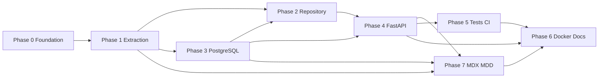

# Kurdish Wiktionary Pipeline — Phased Implementation Plan

**Document version:** 1.1  
**Last updated:** 2026-10-09  
**Companion spec:** [PROJECT_SPEC.md](./PROJECT_SPEC.md)

Use this document as the **source of truth for progress**. Update checkboxes and the **Current phase** section whenever work stops or resumes.

---

## Progress snapshot

| Field | Value |
|-------|--------|
| **Current phase** | Phase 5 — ready to start |
| **Last completed task** | 4.8 |
| **Blockers** | None recorded |
| **Branch / commit** | feat/phase-1-extraction (local) |

### Phase status overview

| Phase | Name | Status | Exit criteria met? |
|-------|------|--------|--------------------|
| 0 | Foundation & tooling | ✅ Done | ✅ |
| 1 | ZIM extraction & schema | ✅ Done | ✅ |
| 2 | Hybrid repository layer | ✅ Done | ✅ |
| 3 | PostgreSQL schema & migrations | ✅ Done | ✅ |
| 4 | FastAPI service | ✅ Done | ✅ |
| 5 | Tests, CI, hardening | ⬜ Not started | ⬜ |
| 6 | Documentation & ops runbook | ⬜ Not started | ⬜ |
| 7 | MDX/MDD export (mdict-utils) | ⬜ Not started | ⬜ |

**Legend:** ⬜ Not started · 🟡 In progress · ✅ Done

---

## How to resume work

1. Read **Progress snapshot** and **Blockers** above.
2. Open the **lowest-numbered phase** not marked ✅.
3. Complete tasks in order within that phase (dependencies listed per task).
4. Run the phase **Verification commands** before marking the phase ✅.
5. Update **Progress snapshot** (phase, last task, commit hash).

---

## Phase 0 — Foundation & tooling

**Objective:** Runnable monorepo skeleton, `uv` project, quality gates, empty app boots.

**Depends on:** Nothing.

### Tasks

- [x] **0.1** Restructure or nest `wiktionary_pipeline/` per spec; keep existing `zim/` at repo root or configure `ZIM_PATH`.
- [x] **0.2** `pyproject.toml`: project metadata, `[tool.uv]`, dependencies (fastapi, uvicorn, sqlalchemy[asyncio], asyncpg, alembic, pydantic-settings, libzim, selectolax, beautifulsoup4, httpx, **mdict-utils**).
- [x] **0.3** Dev dependencies: pytest, pytest-asyncio, pytest-cov, mypy, ruff, testcontainers.
- [x] **0.4** `uv lock` + `uv sync`; document in README.
- [x] **0.5** `src/config.py` — Pydantic Settings (all env vars from spec §12).
- [x] **0.6** `src/core/` — base exceptions (`AppError`, `NotFoundError`, `ZimError`, `DatabaseError`), logging helper.
- [x] **0.7** `ruff` + `mypy` strict config in `pyproject.toml`.
- [x] **0.8** Minimal `src/api/app.py` with empty router; `uvicorn` entrypoint.

### Deliverables

- Installable package; `uv run uvicorn src.api.app:app --reload` starts (health stub OK).

### Verification

```bash
cd /home/dolan/Documents/wikitionary_to_mdx
uv sync
uv run ruff check src tests
uv run mypy src
uv run pytest   # may be empty suite initially
```

---

## Phase 1 — ZIM extraction & canonical schema

**Objective:** Parse real Wîkîferheng HTML into `WiktionaryEntry`; CLI/worker ingests ZIM.

**Depends on:** Phase 0.

### Tasks

- [x] **1.1** `src/core/models.py` — Pydantic `WiktionaryEntry` + validators (normalize lists, metadata defaults).
- [x] **1.2** **Corpus analysis:** Sample 20–50 pages from local `zim/wiktionary_ku_all_nopic_2026-06.zim` (or latest nopic); document HTML patterns in `docs/HTML_LAYOUT_NOTES.md`.
- [x] **1.3** `src/extraction/zim_reader.py` — wrap libzim (thread offload): metadata, iterate paths/titles, fetch HTML bytes.
- [x] **1.4** `src/extraction/html_parser.py` — structural parser; `layout_version` in metadata; null-safe fields.
- [x] **1.5** `src/extraction/normalize.py` — title/lemma normalization for keys.
- [x] **1.6** `src/extraction/pipeline.py` — async batch orchestrator (read → parse → yield models).
- [x] **1.7** CLI `src/extraction/__main__.py` or `wiktionary-ingest` script: `--zim-path`, logging, progress counters.
- [x] **1.8** Unit tests: HTML fixtures (minimal, messy, empty sections) in `tests/unit/test_html_parser.py`.

### Deliverables

- CLI prints parse stats for full ZIM (dry-run mode without DB OK for mid-phase).

### Verification

```bash
uv run python -m src.extraction --zim-path zim/wiktionary_ku_all_nopic_2026-06.zim --dry-run --max-entries 100
uv run pytest tests/unit/test_html_parser.py -v
```

### Resume notes

- If blocked on parser accuracy, extend **1.2** fixture set before tuning selectors in **1.4**.

---

## Phase 2 — Hybrid repository layer

**Objective:** Strategy pattern; service layer agnostic of ZIM vs SQL.

**Depends on:** Phase 1 (models + parser); Phase 3 can parallelize after **2.1** if SQL models stubbed.

### Tasks

- [x] **2.1** `src/repository/protocol.py` — `WiktionaryRepositoryProto` (Protocol or ABC).
- [x] **2.2** `src/repository/zim_repository.py` — `get_entry`, `list_entries` (list may scan titles — document performance limits).
- [x] **2.3** `src/repository/sql_repository.py` — stub then implement after Phase 3.
- [x] **2.4** `src/repository/factory.py` — build repo from Settings + optional header override.
- [x] **2.5** `src/core/services/wiktionary_service.py` — thin domain service over protocol.
- [x] **2.6** Unit tests with mocked ZIM reader and mocked SQL session.

### Deliverables

- Service returns `WiktionaryEntry` from ZIM path for known test lemmas.

### Verification

```bash
uv run pytest tests/unit/test_repository.py tests/unit/test_zim_repository.py -v
```

---

## Phase 3 — PostgreSQL schema & migrations

**Objective:** Normalized async SQLAlchemy models, Alembic, ingest upsert.

**Depends on:** Phase 1 models; integrates with Phase 2 `SqlRepository`.

### Tasks

- [x] **3.1** `src/repository/db/base.py` — async engine, session factory, lifespan helper.
- [x] **3.2** SQLAlchemy 2.0 models under `src/repository/db/models/`.
- [x] **3.3** Alembic `migrations/env.py` (async); initial revision creating all tables + indexes.
- [x] **3.4** Optional migration enabling `pg_trgm` + GIN index (document if extension required).
- [x] **3.5** `src/repository/db/upsert.py` — transactional upsert: parent + replace children.
- [x] **3.6** Wire **1.6** pipeline to upsert (worker path).
- [x] **3.7** Complete **2.3** `SqlRepository` implementations.

### Deliverables

- `alembic upgrade head` on clean Postgres; ingest populates tables idempotently.

### Verification

```bash
docker compose up -d postgres
uv run alembic upgrade head
uv run python -m src.extraction --zim-path zim/wiktionary_ku_all_nopic_2026-06.zim --max-entries 500
# Re-run same command: row counts stable, updated_at changes
uv run pytest tests/integration/test_upsert.py -v
```

---

## Phase 4 — FastAPI service

**Objective:** Production-shaped API with middleware and health.

**Depends on:** Phase 2 + Phase 3 for full SQL path; ZIM-only path can ship earlier.

### Tasks

- [x] **4.1** `src/api/schemas.py` — response DTOs mirroring `WiktionaryEntry`.
- [x] **4.2** `src/api/deps.py` — settings, repo factory, `X-Data-Source` dependency.
- [x] **4.3** `src/api/routers/health.py` — ZIM readable + DB ping.
- [x] **4.4** `src/api/routers/words.py` — list + get by word.
- [x] **4.5** CORS middleware from settings.
- [x] **4.6** Rate limiting middleware (in-memory v1; note Redis for multi-replica).
- [x] **4.7** Exception handlers → RFC 7807-style JSON.
- [x] **4.8** App lifespan: engine dispose, optional ZIM handle cache.

### Deliverables

- OpenAPI docs at `/docs`; both data sources selectable.

### Verification

```bash
docker compose up --build
curl -s localhost:8000/health | jq .
curl -s -H 'X-Data-Source: zim' localhost:8000/words/heval | jq .
curl -s -H 'X-Data-Source: sql' localhost:8000/words/heval | jq .
```

---

## Phase 5 — Tests, CI, hardening

**Objective:** Automated quality gates and coverage ramp.

**Depends on:** Phases 1–4.

### Tasks

- [ ] **5.1** `tests/conftest.py` — event loop, test settings, httpx client, db fixture.
- [ ] **5.2** Integration: testcontainers Postgres + migrated schema.
- [ ] **5.3** API integration tests for `/health`, `/words`, error cases.
- [ ] **5.4** `pytest-cov` in `pyproject.toml`; CI threshold (start 70%, target 90%).
- [ ] **5.5** `.github/workflows/ci.yml` — uv sync, ruff, mypy, pytest, docker build.
- [ ] **5.6** Load smoke: document expected latency for ZIM vs SQL single-get.

### Deliverables

- Green CI on push; coverage report artifact.

### Verification

```bash
uv run pytest --cov=src --cov-report=term-missing
```

---

## Phase 6 — Docker, README, runbook

**Objective:** One-command local stack and operator docs.

**Depends on:** Phases 3–5.

### Tasks

- [ ] **6.1** `docker/api.Dockerfile` — multi-stage, non-root user, uv install.
- [ ] **6.2** `docker/worker.Dockerfile` — ingest job entrypoint.
- [ ] **6.3** `docker-compose.yml` — postgres volume, ZIM bind mount `./zim`, env file template `.env.example`.
- [ ] **6.4** README: quickstart, ingest, API examples, **MDX build link to [MDX_MDD_GUIDE.md](./MDX_MDD_GUIDE.md)**, troubleshooting.
- [ ] **6.5** Update this plan’s **Progress snapshot** to ✅ for all phases when done.

---

## Phase 7 — MDX/MDD export (`mdict-utils`)

**Objective:** Produce MDict 2.0 `.mdx`/`.mdd` from SQL or ZIM; HTTP build/extract jobs; operator documentation complete.

**Depends on:** Phase 1 (entry model + HTML), Phase 2/3 for SQL export path, Phase 4 for API router wiring.

**Primary doc:** [MDX_MDD_GUIDE.md](./MDX_MDD_GUIDE.md)

### Tasks

- [ ] **7.1** `src/mdict/renderer.py` — `WiktionaryEntry` → HTML fragment (MDict-friendly CSS hooks).
- [ ] **7.2** `src/mdict/txt_writer.py` — UTF-8 `dict.txt` stream (`headword\thtml`); handle batch/chunk files for scale.
- [ ] **7.3** `src/mdict/resources.py` — collect media from ZIM or static assets; rewrite HTML URLs to MDD-relative paths.
- [ ] **7.4** `src/mdict/pack.py` — async subprocess wrapper around `mdict` CLI (pack + meta + keys + query smoke).
- [ ] **7.5** `src/mdict/extract.py` — unpack to `MDX_WORK_DIR/{job_id}/`.
- [ ] **7.6** `src/mdict/jobs.py` — in-process or DB-backed job registry (status, progress, errors).
- [ ] **7.7** `assets/mdict/templates/title.html` + `description.html` (Wîkîferheng provenance).
- [ ] **7.8** CLI `python -m src.mdict.export` mirroring POST `/mdx/build` options.
- [ ] **7.9** `src/api/routers/mdx.py` — routes per spec §9.2 (`/mdx/about`, `/mdx/build`, `/mdx/extract`, …).
- [ ] **7.10** OpenAPI: `GET /mdx/about` returns markdown/HTML summary + links (mdict-analysis, writemdict, mdict-utils).
- [ ] **7.11** Unit tests: renderer + txt_writer; integration: 3-entry fixture round-trip pack/unpack.
- [ ] **7.12** API tests: build job with `limit=10`, download zip, verify `mdict -m` on artifact.

### Deliverables

- `build/mdict/wikiferheng.mdx` (+ `.mdd` when `include_media=true` using maxi ZIM).
- Documented manual flow in MDX_MDD_GUIDE §5 matches actual CLI flags.

### Verification

```bash
uv add mdict-utils
uv run python -m src.mdict.export --data-source sql --output-dir build/mdict --limit 100
mdict -m build/mdict/wikiferheng.mdx
mdict -k build/mdict/wikiferheng.mdx | head

curl -s localhost:8000/mdx/about | jq .
curl -s -X POST localhost:8000/mdx/build -H 'Content-Type: application/json' \
  -d '{"data_source":"sql","include_media":false,"limit":50}' | jq .
```

### Resume notes

- If pack fails on encoding, validate UTF-8 on every staged file (mdict-utils requirement).
- Prefer **MDict 2.0** output; do not block on v3 write support.
- For full corpus builds, run as **worker job** not synchronous HTTP.

### Verification

```bash
docker compose up --build
# Full ingest + API queries against SQL
```

---

## Dependency graph (phases)



---

## Risk register

| Risk | Mitigation |
|------|------------|
| libzim is sync-only | `asyncio.to_thread` + bounded pool; cache Archive handle |
| HTML layout drift | `layout_version` + fixture library; soft-fail per page |
| Full ZIM ingest slow | Batching, `--max-entries`, worker container scale |
| `list_entries` from ZIM expensive | Document offset/limit as best-effort or require SQL for large lists |
| No separate kmr/ckb ZIM | Optional post-filter on parsed language sections; store in metadata |
| Rate limit in multi-instance API | v1 in-memory; document Redis for production |
| MDX pack memory/time on full wiki | Chunked `dict.txt`, worker job, optional entry `limit` |
| MDict v3 write unsupported | Target v2.0; document read compatibility for v3 inputs on extract |

---

## Local assets (already on disk)

| File | Use |
|------|-----|
| `zim/wiktionary_ku_all_nopic_2026-06.zim` | Recommended default for ingest dev (newest nopic) |
| `zim/wiktionary_ku_all_nopic_2026-03.zim` | Regression / older layout |
| `zim/wiktionary_ku_all_maxi_2026-08.zim` | Pronunciation audio / images testing + **MDD** resource extraction |

---

## Agent handoff checklist

When stopping mid-implementation, update:

1. **Progress snapshot** — current phase and last completed task ID (e.g. `1.4`).
2. **Blockers** — failing tests, missing deps, parser gaps.
3. Git commit message referencing task IDs.
4. Any new HTML selectors → `docs/HTML_LAYOUT_NOTES.md` (create in Phase 1.2).

---

## Rephrased implementation prompt (for AI / contractor brief)

> **Project:** Kurdish Wiktionary Data Platform  
> **Mission:** Deliver a modular Python 3.12+ system that ingests Kiwix `wiktionary_ku_*.zim` files, normalizes Wiktionary HTML into a strict nullable lexical schema, upserts into PostgreSQL 16+, and exposes an async FastAPI read API that can transparently read from either the database or the ZIM file via a strategy-based repository layer.  
> **Engineering standards:** Manage dependencies with `uv`; enforce `ruff` and strict `mypy`; use SQLAlchemy 2.0 async with Alembic migrations; parse HTML with selectolax (BeautifulSoup4 for tests); wrap libzim appropriately for async contexts; ship multi-stage Docker images and docker-compose for API, worker, and Postgres; implement pytest with asyncio, testcontainers for DB integration, and pytest-cov with a path to 90%+ coverage.  
> **Functional requirements:** (1) Extraction pipeline accepting arbitrary updated ZIM paths, idempotent upsert on `(normalized_entry, language_code)`. (2) Identical JSON entry shape across pipeline and API. (3) Endpoints: `GET /health`, `GET /words`, `GET /words/{word}` with pagination and structured errors. (4) Runtime source selection via `DEFAULT_DATA_SOURCE` and `X-Data-Source: zim|sql`. (5) CORS and rate limiting middleware. (6) MDX/MDD: build and extract via **mdict-utils** with `GET /mdx/about`, async `POST /mdx/build`, `POST /mdx/extract`, and download routes — see [MDX_MDD_GUIDE.md](./MDX_MDD_GUIDE.md).  
> **Parser requirement:** Treat Wiktionary HTML as evolving structure; derive baseline selectors from a sampled corpus; never fail entire ingest on single-page parse errors; encode version hints in `metadata`.  
> **Out of scope v1:** Separate public ZIMs for Kurmanji/Sorani; Wiktionary lemma editing API; MDict v3 **write**.  
> **Definition of done:** CI green; docker compose stack healthy; double ingest produces no duplicates; API responses match schema for both strategies; MDX fixture round-trip passes; README, MDX guide, and phased plan updated with completion status.

This paragraph is the **canonical brief**; technical detail lives in [PROJECT_SPEC.md](./PROJECT_SPEC.md).
