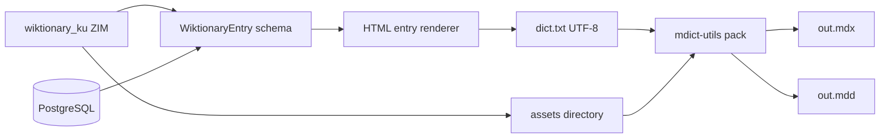

# MDX / MDD Dictionary Export Guide

**Audience:** Developers and operators building Kurdish Wîkîferheng offline dictionaries for [MDict](https://www.mdict.cn/), GoldenDict, and compatible readers.

**Tooling mandate:** Use **[mdict-utils](https://pypi.org/project/mdict-utils/)** ([source](https://github.com/liuyug/mdict-utils)) for pack, unpack, metadata, and key listing. Do not reimplement the binary format in application code except via this library or its CLI.

**Format references (read-only):**

- [mdict-analysis](https://bitbucket.org/xwang/mdict-analysis/src/master/) — MDict file structure and version notes
- [writemdict](https://github.com/zhansliu/writemdict) — alternative writer; useful for understanding index records and resource linking

---

## 1. What are MDX and MDD?

| File | Role |
|------|------|
| **`.mdx`** | Main dictionary database: **headword → HTML definition** (lexical entries, styled text, links). |
| **`.mdd`** | **Resource package**: images, CSS, JavaScript, audio, fonts. HTML in the MDX references paths that resolve inside the MDD (e.g. `sound://hello.mp3`, `img/logo.png`). |

Together they form one offline dictionary users open in MDict-compatible apps. Large Wiktionary exports usually need **both**: MDX for articles and MDD for media pulled from ZIM (especially when using `wiktionary_ku_all_maxi_*.zim`).

### Version support (mdict-utils)

| Operation | MDict 2.0 | MDict 3.0 |
|-----------|-----------|-----------|
| Read (unpack / query) | Yes | Yes |
| Write (pack) | Yes | **No** — pack output targets **2.0** |

Plan exports as **MDict 2.0** unless a future toolchain adds v3 write support.

### Encoding

All source material for pack must be **UTF-8**: `.txt` entry files, `.html` title/description, and resource file names/content as required by the tool.

---

## 2. How this project produces MDX/MDD



1. **Ingest** (Phases 1–3): ZIM → parsed `WiktionaryEntry` → optional SQL upsert.
2. **Render** (Phase 7): Each entry → single HTML fragment (definitions, POS, etymology, examples; link audio/images with MDD-relative paths).
3. **Serialize**: One line per lemma in **source `.txt`** (see §3).
4. **Resources**: Copy/normalize media into a directory tree for MDD pack.
5. **Pack**: Invoke `mdict-utils` with `title.html`, `description.html`, and `-a` inputs.
6. **Verify**: `mdict -m`, `mdict -k`, sample `mdict -q` before shipping.

**Recommended data source for full builds:** `sql` (indexed, repeatable). Use `zim` for quick one-off exports without DB.

---

## 3. Source file formats (pack inputs)

### 3.1 Entry text file (`dict.txt`)

Used with:

```bash
mdict --title title.html --description description.html -a dict.txt wikiferheng.mdx
```

Each record is one line (conceptually **key + definition body**). The pipeline generator MUST emit UTF-8 and escape/control newlines inside HTML so one entry = one line. Exact delimiter rules follow `mdict-utils` expectations (same as legacy MDict builder tools; when in doubt, generate a small sample and round-trip with `mdict -x`).

**Project convention (`src/mdict/txt_writer.py`):** MDict block syntax (see `mdict_utils.writer.pack_mdx_txt`):

```
{headword}
{html_body lines}
</>
```

- `headword`: Wiktionary title / lemma (NFC Unicode).
- `html_body`: Full `<html>...</html>`; include `<link>` to shared CSS in MDD if used.

Multiple part files or a directory of `.txt` files are supported:

```bash
mdict --title title.html --description description.html -a dict.part1.txt -a dict.part2.txt wikiferheng.mdx
# or
mdict --title title.html --description description.html -a txt_dir/ wikiferheng.mdx
```

### 3.2 Title and description HTML

| File | Content |
|------|---------|
| `title.html` | Short dictionary name shown in MDict (e.g. **Wîkîferheng (Kurdish Wiktionary)**). |
| `description.html` | Provenance: ZIM filename, build date, license, link to ku.wiktionary.org. |

Templates live under `assets/mdict/templates/` (to be added in Phase 7).

### 3.3 MDD resource directory

Directory of files preserving **relative paths** referenced from HTML (e.g. `css/wiktionary.css`, `audio/heval.opus`).

Pack:

```bash
mdict --title title.html --description description.html -a resource_dir/ wikiferheng.mdd
```

Place **`wikiferheng.mdx`** and **`wikiferheng.mdd`** in the same folder for MDict clients. Basename alignment is a common convention for auto-loading resources.

---

## 4. mdict-utils CLI reference

Install in the project environment:

```bash
uv add mdict-utils
# provides console script: mdict
```

| Task | Command |
|------|---------|
| Metadata | `mdict -m wikiferheng.mdx` |
| List keys | `mdict -k wikiferheng.mdx` |
| Query one key (smoke test) | `mdict -q wikiferheng.mdx` |
| Unpack MDX | `mdict -x wikiferheng.mdx -d ./out/mdx` |
| Unpack MDD | `mdict -x wikiferheng.mdd -d ./out/mdd` |
| Split unpack (large dicts) | `mdict -x wikiferheng.mdx -d ./out --split-n 5` or `--split-az` |
| Export to SQLite | `mdict -x wikiferheng.mdx --exdb` |
| Pack MDX | `mdict --title title.html --description description.html -a dict.txt wikiferheng.mdx` |
| Pack MDD | `mdict --title title.html --description description.html -a resource_dir/ wikiferheng.mdd` |
| TXT ↔ SQLite helpers | `mdict --txt-db dict.txt` / `mdict --db-txt dict.db` |

**Operational note:** `-q` is for **testing** packed dictionaries, not production lookup (use MDict app or SQL export for bulk reads).

---

## 5. Manual workflow (without API)

Use this while Phase 7 is incomplete or for debugging.

```bash
cd /home/dolan/Documents/wikitionary_to_mdx
uv sync

# 1) Ingest ZIM into SQL (when CLI exists)
uv run python -m src.extraction --zim-path zim/wiktionary_ku_all_nopic_2026-06.zim

# 2) Generate staging files (when export CLI exists)
uv run python -m src.mdict.export \
  --data-source sql \
  --output-dir build/mdict/staging \
  --title-template assets/mdict/templates/title.html \
  --description-template assets/mdict/templates/description.html

# Expected staging layout:
#   build/mdict/staging/dict.txt
#   build/mdict/staging/resources/...
#   build/mdict/staging/title.html
#   build/mdict/staging/description.html

# 3) Pack
mdict --title build/mdict/staging/title.html \
      --description build/mdict/staging/description.html \
      -a build/mdict/staging/dict.txt \
      build/mdict/wikiferheng.mdx

mdict --title build/mdict/staging/title.html \
      --description build/mdict/staging/description.html \
      -a build/mdict/staging/resources \
      build/mdict/wikiferheng.mdd

# 4) Verify
mdict -m build/mdict/wikiferheng.mdx
mdict -k build/mdict/wikiferheng.mdx | head
mdict -q build/mdict/wikiferheng.mdx   # interactive / sample query
```

### Round-trip (extract existing MDX/MDD)

```bash
mdict -x mydict.mdx -d extract/mdx
mdict -x mydict.mdd -d extract/mdd
# Inspect extract/mdx and extract/mdd; optional re-pack after edits
```

---

## 6. HTTP API (planned — Phase 7)

All routes under prefix **`/mdx`**. Responses JSON unless downloading binary artifacts. Long builds run as **async jobs** (avoid request timeouts on ~1M entries).

| Method | Path | Purpose |
|--------|------|---------|
| GET | `/mdx/about` | What MDX/MDD are, tool versions, links to this doc and upstream references. |
| GET | `/mdx/meta` | Query param `path` or uploaded file id — wraps `mdict -m`. |
| GET | `/mdx/keys` | Paginated key list — wraps `mdict -k` (or index from unpack cache). |
| GET | `/mdx/lookup/{headword}` | Single entry HTML — read from unpacked cache or `mdict -q` equivalent. |
| POST | `/mdx/extract` | Body: `{ "mdx_path", "mdd_path"? }` or multipart upload → unpack to `MDX_WORK_DIR`; returns `{ "job_id" }`. |
| GET | `/mdx/extract/{job_id}` | Extract status + output directories listing. |
| POST | `/mdx/build` | Body: `{ "data_source": "sql\|zim", "include_media": true, "zim_path"?, "limit"?, "title"?, "description"? }` → `{ "job_id" }`. |
| GET | `/mdx/build/{job_id}` | Progress: entries rendered, pack phase, errors sample. |
| GET | `/mdx/build/{job_id}/download` | Zip stream containing `.mdx`, optional `.mdd`, and `manifest.json`. |

**Security / ops**

- Restrict `path` parameters to `MDX_WORK_DIR` (no arbitrary filesystem read).
- Rate-limit build endpoints aggressively; one concurrent build per instance by default.
- Log manifest: entry count, ZIM UUID, git commit, `mdict-utils` version.

OpenAPI tag: **`mdx`** — include embedded markdown summary pointing to this file.

---

## 7. Configuration

| Variable | Purpose |
|----------|---------|
| `MDX_WORK_DIR` | Staging, unpack dirs, job artifacts (default `./build/mdict`) |
| `MDX_DEFAULT_TITLE` | Dictionary display name |
| `MDX_BUILD_MAX_CONCURRENT` | Job semaphore (default `1`) |
| `MDX_INCLUDE_MEDIA` | Default `true` when source ZIM is maxi / assets present |

---

## 8. Testing strategy

| Test | Intent |
|------|--------|
| Unit | HTML renderer: `WiktionaryEntry` → one TXT line; path references for MDD |
| Unit | Mock `subprocess` / wrapper around `mdict` CLI |
| Integration | Pack tiny 3-entry fixture → `mdict -m` / unpack → keys preserved |
| Integration | POST `/mdx/build` with `--limit 10` against test DB |

Fixture directory: `tests/fixtures/mdict/` (minimal `dict.txt`, `title.html`, `description.html`).

---

## 9. Troubleshooting

| Symptom | Likely cause | Action |
|---------|--------------|--------|
| MDict shows boxes / mojibake | Non–UTF-8 source | Re-export TXT/HTML as UTF-8 |
| Images/audio missing | MDD not beside MDX or wrong path in HTML | Align basenames; check `sound://` / relative paths |
| Pack fails on huge dict | Memory / time | Split TXT (`-a part1 -a part2`) or `--split-n` on unpack only |
| Keys missing vs Wiktionary | Parser skipped pages | Compare SQL count vs `mdict -k` count; inspect failed ingest log |

---

## 10. License and attribution

- **Wiktionary content:** CC BY-SA (attribute ku.wiktionary.org and contributors).
- **mdict-utils:** MIT ([liuyug/mdict-utils](https://github.com/liuyug/mdict-utils)).
- Document MDict format IP/trademarks as applicable in `description.html` for end users.
